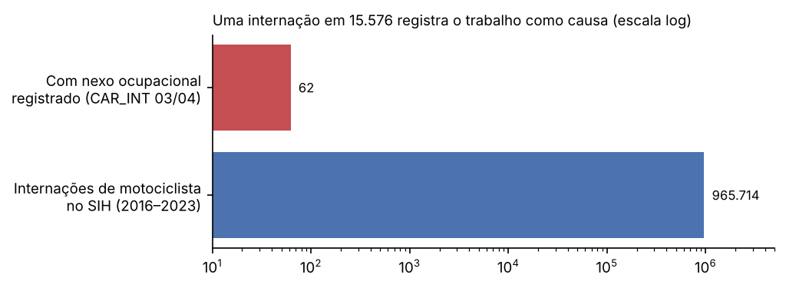
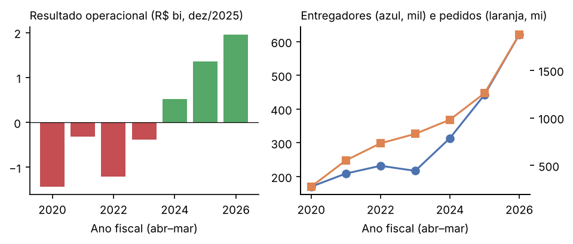
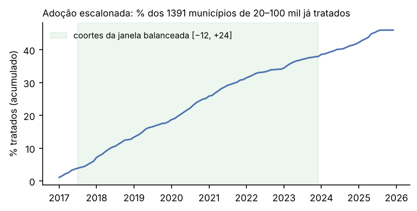
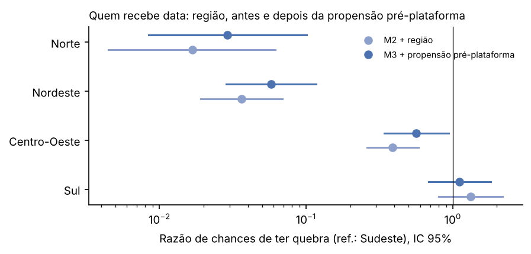

**Resumo.** *Problema:* a expansão das plataformas de entrega com remuneração por corrida coincide com o crescimento das internações de motociclistas no Sistema Único de Saúde (SUS), mas nenhuma base administrativa pública liga uma internação ao trabalho por plataforma, e o debate público trata só do vínculo empregatício, não de quem paga a conta hospitalar. *Objetivo:* medir a carga e o custo público das internações de motociclistas, documentar a invisibilidade ocupacional desses casos nos registros oficiais e construir — antes de olhar o desfecho — um tratamento municipal datado que permita estimar o efeito causal da chegada do entregador por aplicativo. *Métodos:* painel município × mês (2015–2025) montado a partir dos microdados do SIH/SUS (3.563 de 3.564 competências; 433.033 linhas em 5.517 municípios), frota municipal do Senatran, benefícios do INSS, PNAD Contínua e relatórios da Prosus. O tratamento é a quebra estrutural nas aberturas de MEI com CNAE 5320-2/02, detectada por uma regra de teste de Poisson cujos hiperparâmetros foram calibrados por busca em grade contra um placebo pré-plataforma e contra datas externas (Wayback Machine), nunca contra internações. O plano de análise (diferenças em diferenças com adoção escalonada, Callaway & Sant'Anna) foi registrado no OSF antes de qualquer cruzamento tratamento × desfecho. *Resultados:* foram 965.714 internações de motociclistas em 2016–2023, das quais 62 (uma em 15.576) registram nexo ocupacional; o SUS pagou R$ 288 milhões com essas internações em 2025, enquanto o resultado operacional do iFood no mesmo ano foi de R$ 1,8 bilhão. A regra de quebra data 640 municípios de 20 a 100 mil habitantes entre 2017 e 2025, com falso positivo de 0,7% a 3,8% no placebo; 478 entram na janela balanceada de estimação. Dois modelos complementares, sem uso do desfecho, avaliam o tratamento: uma simulação de Monte Carlo da regra reproduz o falso positivo observado abaixo de 100 mil habitantes (0,6% e 3,9% simulados contra 0,7% e 3,8% observados) e mostra que a regra é conservadora (detecta 22–54% dos saltos de 2 a 5 vezes em municípios de 50–100 mil); uma regressão logística de seleção (AUC de validação cruzada 0,91) mostra que Nordeste e Norte têm chance 17 a 34 vezes menor de receber data, mesmo controlando população e propensão pré-plataforma a abrir MEI. *Conclusão:* a carga é grande, crescente e invisível como acidente de trabalho; o desenho causal é viável e está travado por pré-registro. Esta versão entrega a parte descritiva e a construção do tratamento; a estimação causal é a etapa seguinte, já especificada.

**Palavras-chave:** plataformas digitais; entregadores; acidentes de motocicleta; SIH/SUS; diferenças em diferenças; pré-registro.

# 1. Introdução

O Brasil tem hoje cerca de 405 mil motociclistas cuja ocupação principal é mediada por plataforma digital, quase o dobro dos 211 mil de 2022 (PNAD Contínua, microdado, cálculo próprio). Esse contingente trabalha com 85% de informalidade, só 19% contribuem para a Previdência e ganham R$ 11,4 por hora — 62% do rendimento-hora do ocupado médio do setor privado, com cerca de cinco horas a mais por semana. No mesmo período, o líder do setor, o iFood, passou de prejuízo operacional para um resultado de R$ 2,0 bilhões no ano fiscal encerrado em março de 2026, com 1,9 bilhão de pedidos e 621 mil entregadores ativos.

A remuneração por corrida cria incentivo direto à velocidade e ao volume. A hipótese deste trabalho é que a chegada do entregador remunerado por corrida a um município eleva a incidência de internações de motociclistas por acidente de trânsito, e que esse custo é absorvido pelo SUS sem contrapartida — no exato período em que o DPVAT, cujos 45% eram vinculados ao custeio dessas vítimas, foi extinto (2021), retirando cerca de R$ 580 milhões por ano do SUS (Ipea).

O problema de identificação é duro. Primeiro, **o entregador de plataforma não existe como tal em nenhuma base administrativa pública**: não há registro que ligue uma internação a uma plataforma. Segundo, as internações de motociclistas crescem desde antes das plataformas, puxadas pela motorização; uma correlação temporal nada prova. Terceiro, as plataformas entram primeiro nos municípios maiores e mais urbanizados, que diferem dos demais em tudo o que move acidentes.

Este trabalho tem três objetivos: (i) **medir** a carga e o custo público das internações de motociclistas no SUS e sua invisibilidade como acidente de trabalho; (ii) **construir** um tratamento municipal datado — o mês de chegada do entregador por aplicativo — a partir de dados públicos, sem olhar o desfecho; e (iii) **especificar e pré-registrar** a estratégia de identificação causal. Por decisão metodológica deliberada, o cruzamento entre tratamento e desfecho só ocorre depois do depósito do plano de análise no OSF. Esta versão do artigo é, portanto, uma prévia: entrega (i) e (ii) completos, e (iii) como protocolo registrado, com a estimação como etapa seguinte.

A contribuição é dupla. Substantivamente, o debate público brasileiro (PLP 12/2024; julgamento do vínculo no STF, suspenso em junho de 2026) é inteiramente sobre vínculo empregatício; ninguém mede a externalidade fiscal sobre o SUS. Metodologicamente, propomos datar a chegada de uma tecnologia de trabalho não observada por uma quebra estrutural em registros de pessoa jurídica, com hiperparâmetros calibrados contra placebo e validação externa — uma solução reutilizável para outros fenômenos de plataformização.

# 2. Métodos

O trabalho segue o ciclo *Explore → Refine → Model → Evaluate → Produce*. A Tabela M1 mapeia cada etapa ao que foi feito e ao artefato que a reproduz no repositório (`github.com/mrcsvg/vcemal`).

| Etapa | O que foi feito | Artefato |
|---|---|---|
| Explore | Inventário de 6 blocos de fontes; diagnóstico dos campos de causa externa, do quarto dígito do CID e do `CAR_INT`; estudo de evento exploratório MEI × Wayback | `docs/anexo-a-…md`, `make diagnostico` |
| Refine | Definição de caso em código testado; união ordenada de campos de diagnóstico; ponte de municípios Senatran↔IBGE revisada; recuperação de 103 competências faltantes; deflação pelo IPCA | `src/vcemal/cid.py`, `frota.py`, `municipios.py`, `make painel` |
| Model | Regra de detecção de quebra (Poisson) com busca em grade de hiperparâmetros; especificação do estimador DiD escalonado; regressão logística de seleção ao tratamento | `src/vcemal/mei.py`, plano de análise §5, `artigo/modelos_artigo.py` |
| Evaluate | Placebo pré-plataforma (2016), concordância com Wayback, simulação de Monte Carlo da regra (falso positivo e poder), validação cruzada do modelo de seleção, auditoria cega pré-declarada, testes de falha do desenho | `make mei`, `make auditoria`, `artigo/modelos_artigo.py`, plano §6 |
| Produce | Tabelas de custo, lacuna, PNAD, lucro e tratamento; figuras; este artigo | `make custo lacuna pnad lucro contraste`, `artigo/analise_artigo.py` |

## 2.1 Dados

| Fonte | Uso | Granularidade | Cobertura |
|---|---|---|---|
| SIH/SUS — AIH reduzida (RD), DATASUS | Desfecho: internações, valor pago, `CAR_INT` | AIH → município de residência × mês | 2015-01 a 2025-12 |
| Senatran — frota por município e tipo | Denominador (motos que casam com V20–V29) | município × mês | 2016-07 a 2025-12 |
| IBGE — Censo 2022 e estimativas | Universo, faixas, controles | município × ano | — |
| Receita Federal — dados abertos do CNPJ (set/2026) | Tratamento: aberturas de MEI CNAE 5320-2/02 | estabelecimento → município × mês | 2015–2025 |
| INSS — benefícios concedidos | Lacuna previdenciária (espécies acidentárias × previdenciárias) | UF × ano | 2019–2025 |
| PNAD Contínua — módulo de plataformas | Precariedade do trabalho | Brasil, região, UF | 4T2022, 3T2024, 3T2025 |
| Prosus — planilhas de KPI | Receita, resultado, pedidos e entregadores do iFood | Brasil × ano fiscal | FY2019–FY2026 |
| Wayback Machine | Validação externa das datas (Rappi, Uber Eats) | município × intervalo | 2019–2023 |

Todas as fontes são públicas. Nenhum microdado é versionado; o repositório contém o código que os reconstrói (`Makefile`). A única exceção são transcrições de números publicados (Prosus, com citação por célula) e o arquivo de tratamento congelado.

## 2.2 Exploração e preparação (Explore / Refine)

A exploração do SIH revelou três armadilhas que, sem tratamento, invalidariam o desfecho. Cada uma virou regra em código, com teste automatizado:

1. **A causa externa não está no diagnóstico principal.** Pela norma do SIH, o principal registra a lesão (capítulo XIX, S/T) e o código V vai para o secundário. Filtrar `DIAG_PRINC` devolve **zero** internações de motociclista em todo ano (Tabela 1). O caso é identificado pela varredura ordenada `DIAG_SECUN → DIAGSEC1..9 → DIAG_PRINC`, ficando com o primeiro código que cai na definição de caso.
2. **O quarto dígito do CID tem duas tabelas.** Nas categorias terminais (V19, V29, V49), `.3` significa acidente *não* de trânsito. Uma regra única classificaria 60.511 AIH (6,3% do desfecho em 2016–2023) indevidamente como trânsito. V29 sozinha é 67% das internações de motociclista.
3. **O denominador tem que casar com o numerador.** V20–V29 inclui motoneta, ciclomotor e side-car, e exclui triciclo. Usar só a coluna `MOTOCICLETA` do Senatran inflaria a taxa em ~19% (Curitiba, dez/2023).

Além disso: a ponte de nomes de município Senatran→IBGE usa normalização exata mais uma tabela revisada à mão (fuzzy matching foi testado e errou 5 de 39 casos, todos municípios renomeados); 103 competências ausentes do espelho do PySUS foram recuperadas do FTP do DATASUS; resta uma competência faltante (RR, 2022-06), lacuna da própria fonte. Valores monetários são deflacionados pelo IPCA para R$ de dez/2025.

**Tabela 1 — Onde está o código de causa externa (SIH, Brasil).**

| Ano | Motociclista pela causa externa (varredura) | Motociclista em `DIAG_PRINC` |
|---|---|---|
| 2016 | 107.385 | 0 |
| 2019 | 117.577 | 0 |
| 2023 | 145.184 | 0 |

**Definição de caso.** Desfecho: V20–V29 em trânsito (motociclista). Teste do mecanismo: V10–V19 (ciclista, que responde ao mesmo incentivo sem comprar veículo). Placebo: V40–V49 (ocupante de automóvel). O desfecho **não** é restrito a condutor: o quarto dígito `.4` é só 9,4% dos casos (`.9`, não especificado, é 69,5%), e a prática de codificar `.4` varia por hospital de forma correlacionada com urbanização — o mesmo fator que atrai a plataforma.

## 2.3 Construção do tratamento (Model)

**O evento é a chegada do entregador remunerado por corrida, não a do aplicativo.** O iFood operou como *marketplace* de 2011 a 2017 (o restaurante entregava) e só passou a ter frota própria em 2018. Notícias locais datam a chegada do aplicativo, não da frota; uma tentativa de datar pela lista de cidades arquivada na Wayback Machine mostrou que a página do iFood era do lado do consumidor, inservível.

A solução foi usar o cadastro de pessoas jurídicas. Entregadores que se formalizam abrem MEI no CNAE 5320-2/02 (“serviços de entrega rápida”), com endereço na residência — o mesmo município de residência que o SIH registra. No universo, as aberturas passam de 19,4 mil (2017) para 40,2 mil (2018) e 50,4 mil (2019): dobram no ano em que o iFood monta a frota própria, enquanto o MEI em geral cresceu 14–21%. O cadastro guarda CNPJs baixados com a data de início, sem viés de sobrevivência. Como o MEI cobre a minoria dos entregadores, usa-se a **data da quebra**, não o nível.

**Regra de detecção.** Para cada município e mês candidato *t* (2017-01 a 2025-06), seja *W*~t~ o total de aberturas em [*t*, *t*+5] e λ~t~ = 6 × (média mensal de aberturas em [*t*−24, *t*−1]) a expectativa sob a linha de base dos 24 meses anteriores (piso de meia abertura). A quebra dispara no primeiro *t* com

> *W*~t~ ≥ *N*,   *W*~t~ ≥ *k*·λ~t~   e   P(Poisson(λ~t~) ≥ *W*~t~) < 0,01,

e o mês de tratamento é o primeiro mês de [*t*, *t*+5] com abertura.

**Calibração dos hiperparâmetros.** *k* e *N* foram escolhidos por busca em grade, *k* ∈ {1,5; 2; 3} × *N* ∈ {3; 5; 8}, avaliada **apenas** contra (a) um placebo pré-plataforma — a taxa de quebras detectadas em jan–jun/2016, quando nenhuma plataforma tinha frota própria — e (b) 65 datas de entrada de Rappi e Uber Eats com confiança C extraídas da Wayback Machine, além da lista de 453 cidades com frota do iFood. Nenhuma métrica usou internações. *k* = 3 deixava 63% das entradas conhecidas sem quebra ou com quebra tardia; *k* = 1,5 disparava mais no placebo. A configuração escolhida, *k* = 2, *N* = 5, tem 7,7% de atraso nas 65 entradas e detecta quebra até dez/2023 em 85% das 453 cidades da lista de frota do iFood.

**Congelamento.** O arquivo resultante (`docs/fontes/cronologia/tratamento_mei_municipio.csv`) foi congelado com SHA-256 `128999bd…7654a2` antes de qualquer cruzamento com o SIH; o script desta versão verifica o hash antes de rodar.

## 2.4 Estratégia de identificação (pré-registrada)

**Desenho.** Diferenças em diferenças com adoção escalonada, unidade município × mês, estimador de Callaway & Sant'Anna (2021) como principal — o estimador de efeitos fixos bidirecionais (TWFE) é inconsistente com efeitos heterogêneos no tempo de adoção (Goodman-Bacon, 2021) — e Sun & Abraham (2021) como robustez.

**Desfecho:** *Y*~it~ = 100.000 × internações em trânsito~it~ / frota de motos~it~.

**Estimando principal (H1):** média simples dos ATT(*e*) para *e* ∈ [0, +24] meses na janela balanceada *e* ∈ [−12, +24], sem covariáveis, também em % da média pré-tratamento dos tratados. **Grupo de comparação:** *not-yet-treated* (municípios ainda não tratados), entre `datado` e `sem_quebra` — comparar com nunca tratados compararia urbanização, não plataforma. **Erros-padrão:** agrupados nas 510 regiões imediatas do IBGE, porque entregador e paciente circulam na região; cluster em município aparece ao lado, na tabela principal. **Inferência:** bilateral a 5%; H1 é sustentada se o estimando for positivo e o IC 95% excluir zero.

**Hipóteses secundárias:** H2 — gradiente do efeito na intensidade (tercis de aberturas de MEI por mil habitantes nos 12 meses após a quebra); H3 — concentração em homens de 18–39 anos, o perfil do trabalho de entrega (50,4% do desfecho), contra o complemento.

**Testes de falha declarados antes:** (1) placebo em ocupantes de automóvel indistinguível do efeito em motociclistas → tendência geral de trânsito; (2) pré-tendências não paralelas → sem leitura causal; (3) **denominador endógeno** — o mesmo estimador com a frota de motos como desfecho; se o efeito percentual sobre a frota for ao menos metade do efeito sobre internações, a taxa deixa de ser interpretável e o resultado principal passa a ser a contagem.

**Pré-registro.** O plano de análise (seções 1–8, com tradução para o inglês), o protocolo de auditoria e o log de 43 decisões datadas foram depositados no OSF Registries (modelo *OSF Preregistration*) **[DOI/URL DO REGISTRO OSF]**, apontando para a tag `pre-registro-v1` do repositório. Todo desvio posterior vai para o log como análise exploratória declarada.

## 2.5 Avaliação do tratamento: auditoria cega

A regra de quebra é testada por busca independente: amostra sorteada com semente fixa (20261011) de 6 municípios `datado` por faixa de população em cada estrato de ano (2017; 2018–2020; 2021–2025), 12 iscas `sem_quebra` e as 27 capitais — 75 municípios, numa lista única. Dois codificadores, cegos ao SIH, à data da quebra e ao grupo, datam a entrada das plataformas pelo protocolo v1.1. Concorda a quebra que cai no intervalo codificado ±6 meses; o estrato passa com ≥ 2/3 de concordância. As consequências de cada veredito (excluir quebras de 2017 ou de 2021+; ou rebaixar a leitura para “efeito da chegada de entregador formalizado”) foram escritas antes da auditoria começar.

## 2.6 Modelos complementares sobre o tratamento (exploratórios, sem desfecho)

Dois modelos avaliam o tratamento construído antes da estimação causal. Nenhum usa internações; ambos leem só o arquivo congelado e foram registrados no log de decisões como análise exploratória (D-044).

**(a) Simulação de Monte Carlo da regra de quebra.** O mesmo código que gerou o tratamento (`vcemal.mei.detectar_quebra`) é aplicado a séries sintéticas. Para cada um dos 1.710 municípios, a taxa mensal de aberturas é a observada em 2015–2016 (antes de qualquer plataforma; piso de 0,5 abertura em 24 meses, como na regra). Dois experimentos:

- *Falso positivo:* séries sem quebra, de 2014-01 a 2016-12, com 200 réplicas por município, contando quebras na janela do placebo (jan–jun/2016). O nulo é Poisson puro e, depois, gama-Poisson com choques mensais de variância relativa 0,25, 0,5 e 1,0, que representam aceleração local que não é plataforma.
- *Poder:* séries de 2015-01 a 2025-12 com um salto de *r* vezes na taxa em 2019-01, *r* ∈ {2, 3, 5, 10, 20}, com 50 réplicas por município de 20–100 mil. Acerto é a quebra datada entre 5 meses antes (a regra data o primeiro mês da janela com abertura) e 12 meses depois do salto; quebra antes disso é espúria e esconde a verdadeira, porque a regra fica com a primeira.

**(b) Modelo de seleção ao tratamento.** Entre os 1.391 municípios de 20–100 mil, uma regressão logística estima a probabilidade de receber data (`datado` = 1, `sem_quebra` = 0) em três especificações aninhadas: M1, log da população; M2, mais a grande região (referência: Sudeste); M3, mais o log das aberturas de MEI de entrega por ano em 2015–2016, que mede a propensão a formalizar entregadores **antes** das plataformas. Os erros-padrão são agrupados por UF (27 grupos). O poder preditivo é medido pela AUC em validação cruzada estratificada de 5 partes, repetida 10 vezes (semente 20261013). A pergunta não é causal: é se o desbalanço regional da Tabela 4 se explica por porte ou por propensão prévia à formalização — o que diria se os `sem_quebra` são bons controles.

# 3. Resultados

Os resultados abaixo são descritivos ou referem-se à construção do tratamento. **Nenhum cruza tratamento com desfecho**, por regra do pré-registro.

## 3.1 Carga e custo público

Em 2016–2023 o SUS registrou **965.714 internações de motociclistas**; 145.761 só em 2023. O valor pago pelo SUS em 2023 foi de R$ 230,1 milhões nominais (R$ 1.575 por AIH). Como validação externa, a tabulação da Abramet sobre o mesmo SIH dá R$ 221,5 milhões (+3,9%) e R$ 1.561 por AIH (+0,9%); a diferença está na contagem, e a hipótese é safra do dado (reapresentações posteriores). Em 2025, a preços de dez/2025, o SUS pagou **R$ 288 milhões**.

O valor pago é piso: a tabela SUS remunera abaixo do custo, e o componente hospitalar por ferido grave nos parâmetros do Ipea (TD 2565) é duas ordens de grandeza maior que o valor médio da AIH. Por isso o custo social (Ipea) é reportado à parte, como ordem de grandeza, e nunca somado ao valor pago.

## 3.2 Invisibilidade ocupacional

Das 965.714 internações de 2016–2023, **62** têm o campo `CAR_INT` preenchido como acidente no local de trabalho (17) ou de trajeto (45): **uma em 15.576** (Figura 4). Em 2023 foram 10. O grupo placebo (ocupantes de automóvel) teve zero.

{width=85%}

A Previdência repete a cegueira. De 2019 a 2023 houve de 5 a 7 benefícios do INSS com CID V20–V29 por mil internações de motociclista no SIH, e só 1 a 1,3 por mil com nexo acidentário reconhecido. Em 2024–2025 a razão salta para 12,5 e 15,4 por mil, mas a exploração mostrou que se trata de **quebra de série**, não de mudança de risco: a partir de nov/2023 a concessão por análise documental (Atestmed) passa a dominar, e o atestado registra o código V muito mais que a perícia (0,6–0,7 contra 0,03–0,13 por mil benefícios). Esse canal responde por 65% dos benefícios de motociclistas em 2024–2025; anos dos dois lados da quebra não se comparam pelo total.

## 3.3 Precariedade e lucro

**Tabela 2 — Motociclistas plataformizados (PNAD Contínua, microdado; R$ do 3T2025).**

| | 2022 | 2024 | 2025 |
|---|---|---|---|
| Pessoas (mil) | 211 | 351 | 405 |
| Informalidade | 77,6% | 84,2% | 85,2% |
| Contribuem para a Previdência | 20,8% | 21,6% | 19,4% |
| Horas por semana | 47,3 | 45,2 | 44,9 |
| Rendimento-hora real | R$ 9,6 | R$ 11,4 | R$ 11,4 |
| Rendimento-hora real, setor privado | R$ 16,6 | R$ 17,7 | R$ 18,4 |

O pipeline reproduz, com erro de arredondamento, todos os números do informativo do IBGE para 2024 (1.654 mil plataformizados; 71,1% informais; 35,9% contribuintes; R$ 15,4/h), o que valida o recorte novo de motociclistas, que o IBGE não publica. Com 84% de informalidade, não há folha sobre a qual incida a contribuição de Riscos Ambientais do Trabalho (RAT) que financia o benefício acidentário de trabalhadores formais.

{width=100%}

O resultado operacional do iFood cruza o zero em FY2024 e quase quadruplica em dois anos; os entregadores ativos dobram de 314 mil para 621 mil (Figura 3). No ano civil de 2025 (interpolado), o EBIT ajustado de R$ 1,8 bilhão é cerca de **seis vezes** o que o SUS pagou com todas as internações de motociclistas do país no mesmo ano (R$ 288 milhões, ambos em R$ de dez/2025). Com ~1,7 bilhão de pedidos no ano, menos de R$ 0,20 por pedido cobriria essa conta. Esse número dimensiona uma política, mas não a justifica: a fração das internações atribuível à plataforma é exatamente o que a estimação causal vai medir.

## 3.4 O tratamento construído

**Tabela 3 — Grupos do tratamento por faixa de população (Censo 2022) e taxa de disparo do placebo de 2016.**

| Faixa | Municípios | `datado` | `sem_quebra` | `coorte_precoce` | Placebo 2016 dispara |
|---|---|---|---|---|---|
| 20–50 mil | 1.053 | 376 | 677 | — | 0,7% |
| 50–100 mil | 338 | 264 | 74 | — | 3,8% |
| 100–250 mil | 203 | — | — | 203 | 24,1% |
| 250 mil+ | 116 | — | — | 116 | 25,9% |
| **Total** | **1.710** | **640** | **751** | **319** | |

A taxa de falso positivo do placebo define onde a regra vale. Abaixo de 100 mil habitantes ela é baixa (0,7% e 3,8%); acima, com muitas aberturas, qualquer aceleração local passa no teste (≈ 25%). Por isso os 319 municípios de 100 mil+ — todos com iFood já em 2019 — formam uma **coorte precoce** fora da estimação principal, e a variação temporal vem dos 640 municípios `datado` de 20–100 mil.

{width=95%}

As quebras se espalham por todo o período (Figura 1), com pico em 2018–2021 — coerente com o *rollout* da frota própria do iFood (cerca de 900 municípios em 2019 e 1.500 em 2023–2025). A Figura 2 mostra a adoção escalonada: ao fim de 2025, 46% dos 1.391 municípios de 20–100 mil estão tratados, o que preserva um grupo *not-yet-treated* ao longo de toda a janela.

{width=95%}

**Janela de estimação.** Com a frota municipal começando em jul/2016 e o SIH terminando em dez/2025, a janela balanceada [−12, +24] admite coortes de 2017-07 a 2023-12: **478 dos 640** municípios `datado`. Ficam de fora 50 com quebra anterior e 112 com quebra posterior, que voltam nas versões não balanceada e de contagem.

**Tabela 4 — Grupos por grande região.**

| Região | `datado` | `sem_quebra` | `coorte_precoce` | % `datado` entre 20–100 mil |
|---|---|---|---|---|
| Sudeste | 288 | 104 | 149 | 73% |
| Sul | 168 | 48 | 55 | 78% |
| Centro-Oeste | 54 | 45 | 25 | 55% |
| Nordeste | 106 | 422 | 64 | 20% |
| Norte | 24 | 132 | 26 | 15% |

A exploração revelou um desbalanço regional que não estava previsto: no Nordeste e no Norte, só 15–20% dos municípios de 20–100 mil têm quebra, contra 73–78% no Sul e no Sudeste. Isso pode refletir chegada mais tardia das plataformas — ou apenas menor propensão à formalização via MEI, caso em que parte dos `sem_quebra` nordestinos estaria tratada sem ser vista. A seção 4 discute a consequência.

## 3.5 A regra simulada: calibrada onde é usada, conservadora e incapaz de datar cidades grandes

**Tabela 5 — Falso positivo da regra na janela do placebo (% de municípios com quebra em jan–jun/2016).**

| Faixa | Poisson puro | Superdispersão 0,5 | Superdispersão 1,0 | Observado |
|---|---|---|---|---|
| 20–50 mil | 0,3 | 0,5 | 0,6 | 0,7 |
| 50–100 mil | 2,0 | 3,1 | 3,9 | 3,8 |
| 100–250 mil | 4,2 | 8,6 | 12,0 | 24,1 |
| 250 mil+ | 2,1 | 9,4 | 16,8 | 25,9 |

Abaixo de 100 mil habitantes, o falso positivo observado é exatamente o que ruído de contagem com superdispersão moderada produz (Tabela 5 e Figura 5, à esquerda): as quebras espúrias ali são acaso. Acima de 100 mil, o placebo observado é o dobro do que mesmo uma superdispersão forte gera — há acelerações locais reais nas aberturas antes de qualquer plataforma, que a regra não distingue da chegada do entregador. A simulação confirma, por um caminho independente, o corte de 100 mil que o desenho já adotava: a regra não serve para datar cidades grandes, e a coorte precoce não é escolha arbitrária.

{width=100%}

**Tabela 6 — Poder da regra: % dos saltos corretamente datados.**

| Salto na taxa de aberturas | 2× | 3× | 5× | 10× | 20× |
|---|---|---|---|---|---|
| 20–50 mil | 4,5 | 9,9 | 19,7 | 37,3 | 67,5 |
| 50–100 mil | 21,7 | 37,5 | 53,4 | 68,8 | 83,6 |

A regra é **conservadora** (Tabela 6 e Figura 5, à direita). Como exige ao menos 5 aberturas em 6 meses, num município de 20–50 mil — mediana de zero abertura por mês em 2015–2016 — só saltos de 10 vezes ou mais são datados com frequência. Quando data, data bem: o atraso mediano é de 0 a 2 meses, e a quebra espúria anterior ao salto ocorre em 1% (20–50 mil) e 5% (50–100 mil) das séries. A consequência direta é que parte dos 751 `sem_quebra` recebeu plataforma, mas com poucos entregadores formalizados para a regra ver. Isso atenua o efeito estimado e dá peso empírico à robustez pré-registrada que exclui os `sem_quebra` do grupo de comparação.

## 3.6 Quem recebe data: o desbalanço regional não é porte nem formalização prévia

**Tabela 7 — Regressão logística de P(`datado`) entre os 1.391 municípios de 20–100 mil: razões de chance (IC 95%, erros agrupados por UF) e ajuste.**

| | M1 | M2 | M3 |
|---|---|---|---|
| log(população) | 11,8 (7,8–17,7) | 44,9 (27,0–74,7) | 25,9 (14,7–45,7) |
| Sul | | 1,33 (0,80–2,19) | 1,11 (0,68–1,82) |
| Centro-Oeste | | 0,39 (0,26–0,58) | 0,56 (0,34–0,94) |
| Nordeste | | 0,036 (0,019–0,069) | 0,058 (0,028–0,117) |
| Norte | | 0,017 (0,005–0,062) | 0,029 (0,008–0,101) |
| log(aberturas/ano 2015–16) | | | 1,92 (1,58–2,33) |
| AUC (validação cruzada 5×10) | 0,755 ± 0,021 | 0,904 ± 0,018 | 0,912 ± 0,017 |
| Pseudo-R² de McFadden | 0,16 | 0,44 | 0,46 |

A população sozinha discrimina razoavelmente (AUC 0,76); acrescentar a região leva a AUC a 0,90, e a propensão pré-plataforma acrescenta quase nada (0,91). Controlando porte e propensão prévia a formalizar entregadores, um município nordestino tem chance **17 vezes menor** de receber data que um do Sudeste de mesmo porte, e um do Norte, **34 vezes menor** (Figura 6). A propensão prévia é relevante (quase o dobro da chance por unidade de log) mas absorve pouco do efeito regional: as razões de chance de Nordeste e Norte sobem só de 0,036 para 0,058 e de 0,017 para 0,029.

{width=95%}

Duas leituras são compatíveis com isso, e o dado do CNPJ não separa uma da outra: as plataformas chegaram mais tarde (ou não chegaram) às cidades médias do Nordeste e do Norte, ou chegaram, mas a formalização dos entregadores *depois* da chegada é regionalmente diferente — o que a simulação da seção 3.5 diz que a regra não veria. Em qualquer das duas, o grupo de comparação *not-yet-treated* mistura regiões com trajetórias distintas.

# 4. Discussão

**O que já se sabe.** A carga é grande (perto de 150 mil internações por ano), crescente e invisível: o sistema de informação em saúde vê o trabalho em uma internação a cada 15.576, e a Previdência, em uma a duas por mil. A população exposta cresceu e se precarizou, enquanto o setor tornou-se lucrativo. Esses fatos não dependem de identificação causal e sustentam, por si, a política mais barata da lista: tornar obrigatório o registro do nexo “trabalho por plataforma” na AIH e no SINAN.

**O que ainda não se sabe — e por que esta versão não responde.** Quanto do crescimento das internações é *causado* pela chegada do entregador por corrida. Essa fração é o que converte “o SUS paga por acidentes de moto” em “o SUS paga por acidentes que a remuneração por corrida causou”. Optamos por não estimá-la antes do depósito do plano no OSF: o número de escolhas defensáveis (agregação dos efeitos dinâmicos, grupo de comparação, nível de cluster, janela, desfecho em taxa ou contagem) é grande o bastante para que qualquer resultado obtido antes do registro fosse suspeito de busca por especificação. O estimando, o critério de inferência e as consequências de cada teste de falha estão fixados.

**Limitações já conhecidas, com a direção do viés.** Três razões fazem do coeficiente a ser estimado um **piso**, e são distintas: (1) *diluição* — o desfecho inclui todos os motociclistas, não só entregadores (desenho ecológico); (2) *contaminação do pré-período* — o *marketplace* já operava antes da frota própria; (3) *denominador endógeno* — se a plataforma faz gente comprar moto, a taxa é atenuada (teste 3). Além disso: o tratamento data a chegada de **oferta de entregador formalizado**, de qualquer plataforma, não a da plataforma X; quebras de 2017 podem ser espúrias e as de 2021+ podem refletir a entrega de comércio eletrônico (ambas auditadas, com consequência escrita); o município de residência não é o do acidente, o que justifica o cluster regional; e o desbalanço regional da Tabela 4 sugere que `sem_quebra` contém municípios tratados não detectados, o que contamina o grupo de comparação e atenua o efeito. As seções 3.5 e 3.6 dão número a essa última ameaça, que tem duas faces: a simulação mostra que a regra perde a maioria das chegadas modestas em municípios pequenos, e o modelo de seleção mostra que quem fica sem data é, sobretudo, nordestino e nortista, independentemente de porte e de formalização prévia. A robustez pré-registrada que exclui os `sem_quebra` responde à primeira face; para a segunda, a análise propõe, como exploratória declarada, (i) o estimador com efeitos fixos de região × mês, comparando só municípios da mesma grande região, e (ii) a estimação restrita a Sul e Sudeste, onde 73–78% dos municípios têm data e o grupo de comparação é mais homogêneo.

**Implicações.** O debate brasileiro é sobre vínculo; a externalidade fiscal não depende dele. Se H1 for sustentada, a fração atribuível dá a base de cálculo para uma contribuição acidentária das plataformas sobre o valor das corridas — equivalente funcional do RAT —, ou um repasse por corrida ao SUS no molde do que o DPVAT fazia. Se não for, a invisibilidade documentada aqui continua sendo, sozinha, argumento para mudar o registro.

# 5. Conclusão

O trabalho responde ao primeiro objetivo — medir carga, custo e invisibilidade — com números reproduzíveis e validados contra referências externas: ~150 mil internações de motociclistas por ano no SUS, R$ 288 milhões pagos em 2025, uma em 15.576 com nexo ocupacional registrado, numa força de trabalho 85% informal, ao lado de uma plataforma líder com R$ 1,8 bilhão de resultado operacional. Responde ao segundo objetivo construindo, sem olhar o desfecho, um tratamento municipal datado para 640 municípios, com hiperparâmetros calibrados contra placebo e validação externa e com taxa de falso positivo baixa onde é usado. Os modelos complementares acrescentam três conclusões sobre o próprio instrumento: (1) a regra está calibrada onde é usada — o falso positivo abaixo de 100 mil habitantes é o do ruído de contagem —, e a simulação confirma de forma independente que ela não data cidades grandes; (2) a regra é conservadora, e os `sem_quebra` contêm tratados não detectados, o que torna o efeito estimado um piso por mais uma razão; (3) a seleção ao tratamento é fortemente regional e não se explica por porte nem por formalização prévia, o que pede comparações dentro da região. O terceiro objetivo está especificado e travado em pré-registro; a estimação causal, com essas duas especificações regionais como exploratórias declaradas, e a auditoria cega do tratamento são as próximas etapas.

# Materiais complementares

- **Código e documentação:** `github.com/mrcsvg/vcemal` (MIT; textos CC BY 4.0). Pipeline completo por `Makefile`; `make test` roda sem rede e sem dado. Log de 44 decisões datadas em `docs/decisoes.md`; dicionário do painel em `docs/dicionario-painel.md`.
- **Dados:** não versionados, por volume (D-009); todas as fontes são públicas e o inventário (`docs/anexo-a-inventario-fontes-de-dados.md`) traz órgão, URL, cobertura, formato e latência de cada uma. Versionados: tratamento congelado (com hash) e transcrição citada da Prosus.
- **Scripts desta versão:** `artigo/analise_artigo.py` gera as Figuras 1–4, e `artigo/modelos_artigo.py` a simulação, o modelo de seleção e as Figuras 5–6 (≈ 25 s). Ambos leem só os arquivos versionados, sem rede, conferem o hash do tratamento e escrevem as tabelas em `artigo/tabelas/`.
- **Bibliotecas:** Python ≥ 3.11; pandas, numpy, scipy, pyarrow, PySUS ≥ 2.11, matplotlib, requests (versões em `pyproject.toml`); para os modelos desta versão, statsmodels 0.14 e scikit-learn 1.x.
- **Hiperparâmetros:** regra de quebra *k* = 2, *N* = 5, α = 0,01, linha de base de 24 meses, janela de 6 meses, piso de 0,5 abertura; grade avaliada *k* ∈ {1,5; 2; 3} × *N* ∈ {3; 5; 8}. Estimação: janela [−12, +24], comparação *not-yet-treated*, cluster em região imediata, α = 0,05 bilateral. Semente da auditoria: 20261011. Modelos complementares: semente 20261013; 200 réplicas por município no falso positivo e 50 no poder; superdispersão gama de variância relativa 0,25, 0,5 e 1,0; regressão logística sem penalização (statsmodels) para as razões de chance e `LogisticRegression` com regularização L2 padrão (scikit-learn, C = 1) para a AUC.
- **Pré-registro:** OSF **[DOI/URL]**; texto do formulário em `docs/pre-registro/deposito-osf.md`.
- **Checklist REFORMS:** documento anexo (`artigo/reforms.md`).

# Declaração de uso de IA generativa

A equipe utilizou o assistente Claude (Anthropic), via Claude Code, como apoio à elaboração e revisão de código do pipeline e de testes, à organização do log de decisões e à redação e revisão textual desta versão do artigo e do checklist REFORMS. Todas as decisões metodológicas, os números reportados e as referências foram conferidos pela equipe, que assume integral responsabilidade pelo conteúdo. **[AJUSTAR CONFORME O USO EFETIVO DA EQUIPE]**

# Referências

ABRAMET — Associação Brasileira de Medicina de Tráfego. Internações de motociclistas no SUS (tabulação do SIH/SUS), 2024.

CALLAWAY, B.; SANT'ANNA, P. H. C. Difference-in-differences with multiple time periods. *Journal of Econometrics*, v. 225, n. 2, p. 200–230, 2021.

CARVALHO, C. H. R. *Custos dos acidentes de trânsito no Brasil: estimativa simplificada com base na atualização das pesquisas do Ipea sobre custos de acidentes nos aglomerados urbanos e rodovias*. Texto para Discussão n. 2565. Brasília: Ipea, 2020.

DATASUS. *Sistema de Informações Hospitalares do SUS (SIH/SUS) — Estrutura dos arquivos RD e notas técnicas de morbidade hospitalar por causas externas*. Brasília: Ministério da Saúde.

GOODMAN-BACON, A. Difference-in-differences with variation in treatment timing. *Journal of Econometrics*, v. 225, n. 2, p. 254–277, 2021.

IBGE. *PNAD Contínua: Teletrabalho e trabalho por meio de plataformas digitais 2024*. Rio de Janeiro: IBGE, 2025.

KAPOOR, S. et al. REFORMS: Consensus-based recommendations for machine-learning-based science. *Science Advances*, v. 10, n. 18, eadk3452, 2024.

NOSEK, B. A. et al. The preregistration revolution. *Proceedings of the National Academy of Sciences*, v. 115, n. 11, p. 2600–2606, 2018.

PROSUS N.V. *KPI datasheets*, anos fiscais 2021 a 2026. Amsterdã: Prosus. Disponível em: prosus.com (URLs por célula em `docs/fontes/ifood_prosus.csv`).

ROTH, J. et al. What's trending in difference-in-differences? A synthesis of the recent econometrics literature. *Journal of Econometrics*, v. 235, n. 2, p. 2218–2244, 2023.

SUN, L.; ABRAHAM, S. Estimating dynamic treatment effects in event studies with heterogeneous treatment effects. *Journal of Econometrics*, v. 225, n. 2, p. 175–199, 2021.
